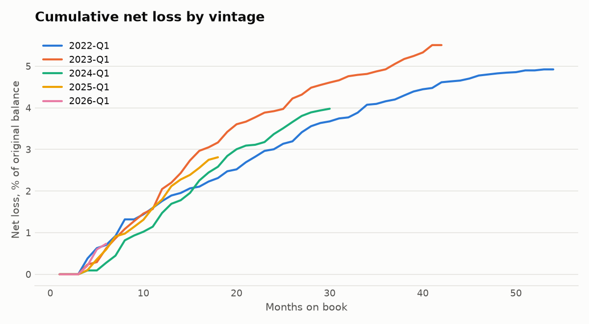
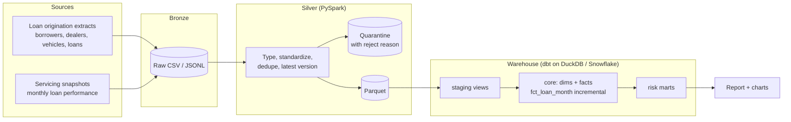
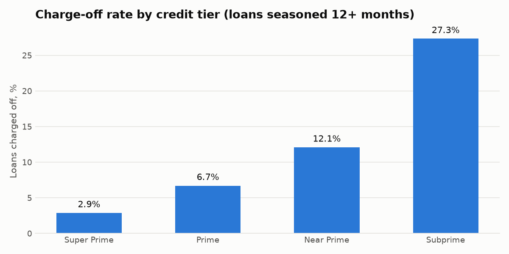
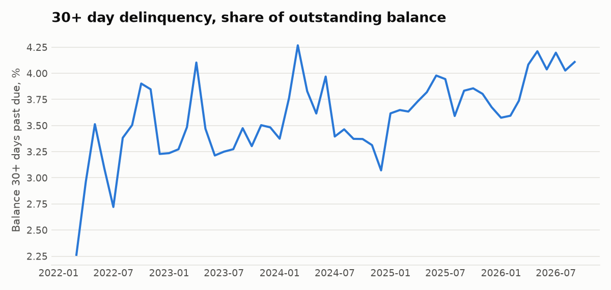

# Automotive Loan Risk Analytics

[](https://github.com/Kolli-Jahnavi-07/automotive-loan-risk-analytics/actions/workflows/ci.yml)

**At a glance:** PySpark + dbt + Snowflake + Airflow · 477K servicing records cleaned with full quarantine audit · star schema with incremental facts · 50 dbt models and tests plus 12 unit tests · vintage, delinquency, and dealer-risk marts.

An end-to-end data platform for an auto-lending portfolio: raw loan and servicing
extracts are cleaned with **PySpark**, modeled into a star schema with **dbt**, and
turned into the risk reporting a credit team uses every month: delinquency trends,
vintage loss curves, loss by credit tier and loan-to-value, and a dealer early-default
review queue.

The same dbt models run on **DuckDB** locally and in CI, and on **Snowflake** in
production, with Snowpipe loading the silver layer and **Airflow** orchestrating the
daily run.



## Architecture



| Layer | What happens | Code |
|---|---|---|
| Bronze | Raw extracts as delivered, including duplicates, mixed date formats, late corrections | `src/loanrisk/generate.py` |
| Silver | PySpark enforces schemas, parses both date formats, removes exact duplicates, keeps the newest version of each servicing snapshot, and **quarantines** bad records with a reason instead of dropping them | `src/loanrisk/spark_silver.py` |
| Core | Star schema: `dim_borrower`, `dim_dealer`, `dim_vehicle`, `dim_month`, `fct_loan_origination`, and `fct_loan_month` (incremental, reprocesses recent months to absorb late corrections) | `dbt/loan_warehouse/models/core` |
| Risk marts | Portfolio delinquency and losses, vintage curves, loss by segment, dealer early-default review | `dbt/loan_warehouse/models/risk` |
| Production | Snowflake schemas, roles, stage, and Snowpipe auto-ingest; Airflow DAG | `snowflake/`, `orchestration/dags/` |

## Results

From a full run on 20,000 synthetic loans (`make all`). Full tables: [`docs/results.md`](docs/results.md).

**Cleaning.** The Spark job read 477,390 servicing records and wrote 474,515. It kept the newest version of 1,585 corrected snapshots, quarantined 238 orphan records, and held 1,052 records whose parent loan was rejected so they can be replayed once the loan is fixed. It also removed 100 duplicate loans from a re-sent extract and quarantined 42 loans with a negative amount.

**Risk.** Losses separate cleanly by credit quality and collateral, the way a real auto book does:

| Credit tier | Avg APR | Charge-off rate | Net loss rate |
|---|---:|---:|---:|
| Super prime | 7.1% | 2.9% | 1.2% |
| Prime | 9.9% | 6.7% | 2.8% |
| Near prime | 14.2% | 12.1% | 5.1% |
| Subprime | 20.2% | 27.3% | 12.2% |

Charge-offs rise from 6.3% on loans under 80% LTV to 14.9% at 100–120% LTV.

**Dealer review.** The generator secretly gives five dealers riskier lending and keeps that answer key outside the pipeline. The dealer-risk mart caught **all 5**, plus 4 ordinary dealers with an unlucky run of about 100 loans. That's why it produces a review queue ranked by z-score rather than an automatic block.

<p>
  
  
</p>

## Data quality

Data is checked at two layers, so bad records are caught early and bad models never reach the marts:

* **Spark (silver):** schema enforcement, value ranges, referential checks, and a quarantine table per source with the reject reason. Every run writes `data/metrics/silver_run.json` with rows read, written, deduplicated, and quarantined.
* **dbt (warehouse):** 35 tests run by `dbt build`. They cover unique and not-null keys, relationships between facts and dimensions, and accepted values and ranges (via a custom `accepted_range` generic test). Four singular tests encode business rules:
  * one row per loan per month
  * no performance before origination
  * charged-off and paid-off loans stay closed
  * recoveries never exceed the charge-off

  Because `dbt build` tests each model before building the next, a failing test stops the marts from refreshing with bad data.

Unit tests (`pytest`) cover the payment math, determinism, and every Spark cleaning rule.

## Run it

Requires Python 3.11+ and Java 17+.

```bash
pip install -r requirements.txt
make all          # generate -> Spark silver -> dbt build (models + tests) -> report
make test         # unit tests
make all LOANS=3000   # smaller, faster run
```

Query the results directly:

```bash
duckdb data/warehouse.duckdb "select * from risk.mart_portfolio_monthly order by as_of_month desc limit 6"
```

CI (GitHub Actions) runs the unit tests and the full pipeline on 3,000 loans on every push.

## Design decisions

* **Quarantine, don't drop.** Rejected records keep their reason, so a data issue becomes a ticket rather than silently missing loans in a loss report.
* **Latest version wins.** Servicing systems re-send corrected snapshots. Silver keeps the newest `ingested_at` per loan and month, and the incremental fact model reprocesses the last two months (`late_arrival_months`) so those corrections reach the marts.
* **Fair vintage curves.** Each vintage is cut at the months-on-book its youngest loan has fully observed. Otherwise partially seasoned months would understate losses for recent vintages.
* **Seasoned segments only.** Segment loss rates use loans with 12+ months on book, so young, low-loss loans don't flatter riskier segments.
* **Portable SQL.** Date logic uses dbt's cross-database macros (`dbt.datediff`, `dbt.dateadd`, `dbt.date_trunc`), so the same models compile for DuckDB and Snowflake.

## Project layout

```
src/loanrisk/          generator and Spark silver job
dbt/loan_warehouse/    staging, core, risk models; macros; tests
snowflake/             production setup and Snowpipe
orchestration/dags/    Airflow DAG
scripts/report.py      builds docs/results.md and charts from the marts
tests/                 unit tests
```

## About the data

All data is **synthetic**, produced by `src/loanrisk/generate.py` with a fixed seed. Monthly performance comes from a roll-rate model in which delinquency, cures, prepayment, and charge-off probabilities depend on credit score, loan-to-value, term, and new vs. used. It describes no real borrowers or lender.

The Snowflake scripts and the Airflow DAG are deployment templates. CI checks that the DAG compiles but does not run Snowflake or Airflow.
